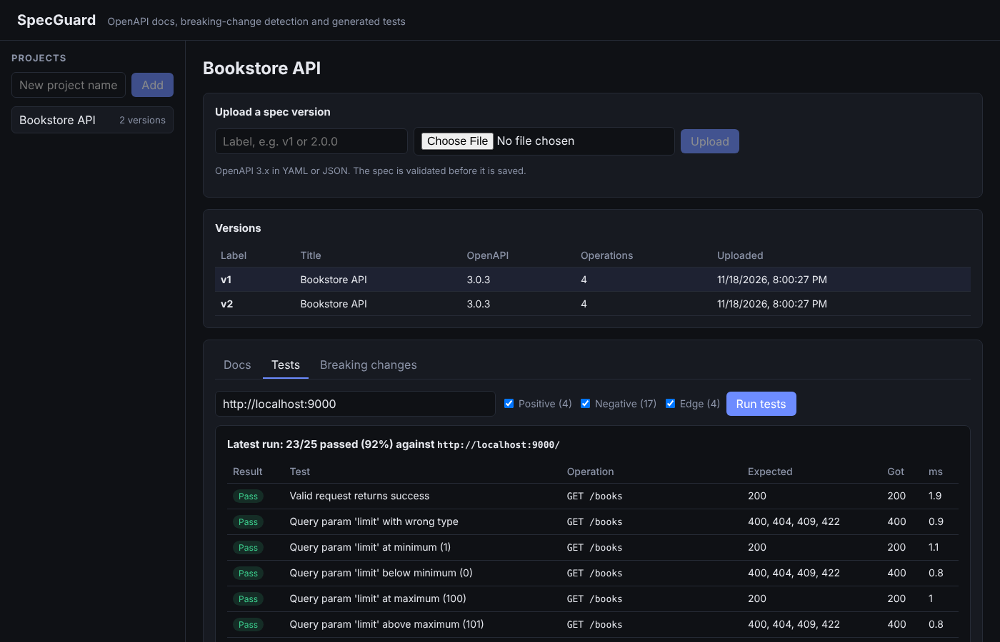

# SpecGuard

**Intelligent API analysis platform.** Upload an OpenAPI 3.x spec and SpecGuard will:

- **Generate documentation** with parameter tables, request/response examples and ready-to-run `curl` commands
- **Detect breaking changes** between two versions of a spec, classified as *breaking*, *warning* or *info*
- **Generate test cases** (positive, negative and edge cases) straight from the schema
- **Run those tests** against a live API and report pass/fail per case
- **Lint the spec** for structural problems such as undeclared path parameters and duplicate operationIds
- **Detect drift** between your source code and the spec: routes that are undocumented, or documented but not implemented
- **Answer questions** about the API, grounded in the spec and your code's docstrings, with cited sources


## Why

When an API changes, the question is always the same: *will this break my clients?* Reading a YAML diff doesn't answer it. SpecGuard compares two specs semantically and applies direction-aware rules. For example, a new **required request field** breaks existing clients, while a new **response field** doesn't. It then generates boundary and validation tests so you can check that the implementation actually honours the contract.

## Features

| Area | What it does |
|---|---|
| Parser | OpenAPI 3.0/3.1 in JSON or YAML, local `$ref` resolution (recursion-safe), path-level parameter merging, `allOf` flattening |
| Docs | Markdown grouped by tag, field tables with constraints, example payloads, `curl` snippets, downloadable from the UI |
| Diff | Removed operations/parameters/responses, type changes, new required params or fields, tightened `min`/`max`/`length` constraints, enum changes, content-type changes, deprecations |
| Test generation | Valid requests, missing required params/fields, wrong types, enum violations, min/max and length boundaries |
| Runner | Executes cases over HTTP with timeouts, stores every run in PostgreSQL with status, timing and response excerpt |
| Lint | Undeclared or unused path params, path params not marked required, duplicate `operationId`s, missing or non-2xx-only responses, unresolvable `$ref`s, bodies on `GET`/`DELETE` |
| Drift detection | Scans uploaded source (files or a `.zip`) for FastAPI/Flask routes via Python's `ast`, Express-style JS/TS routes via regex, and ASP.NET Core controllers and minimal APIs via Roslyn, then matches them to spec operations by path shape (`/books/{book_id}` = `/books/{bookId}`) |
| C# scanner (.NET) | Separate .NET 10 service using Roslyn syntax trees: `[Route]`/`[Http*]`/`[AcceptVerbs]` attributes, `[controller]`/`[action]` tokens, `~/` overrides, route constraints, `MapGroup` prefixes, XML doc summaries |
| Q&A (RAG) | Operations and route docstrings are chunked and ranked with BM25; answers come from any OpenAI-compatible LLM with cited chunk ids, or an extractive answer when no LLM is configured |
| CI-friendly | `POST /analyze/diff` and `POST /analyze/lint` take raw specs, so they can gate a pipeline |

## Architecture

```
frontend/  React + TypeScript (Vite)          ──HTTP──▶  backend/  FastAPI  ──HTTP──▶  scanner-dotnet/  .NET 10
                                                                │                        Roslyn route scanner
                                                                │                        (.cs files from drift scans)
                                                     app/core/  parser → schema → docs
                                                                        ├─▶ lint
                                                                        ├─▶ diff
                                                                        ├─▶ testgen → runner
                                                                        └─▶ rag (BM25 + LLM)
                                                     app/core/  codescan ──┘  (routes + docstrings)
                                                                │
                                                        PostgreSQL (SQLAlchemy 2.0)
                                        projects · spec_versions · test_runs · code_scans
```

C# analysis lives in its own .NET service because Roslyn, the C# compiler platform, is the
right tool for reading C# code: it parses real syntax trees rather than guessing with regexes.
The Python backend sends it `.cs` files over HTTP and merges the routes it returns.

Everything downstream works on one normalized model (`app/core/parser.py`), so `$ref` handling and parameter merging live in a single place. The core modules have no web or database dependencies and are unit-tested on their own.

## Quick start

### With Docker

```bash
docker compose up --build
```

UI at http://localhost:5173, API docs (Swagger) at http://localhost:8000/docs.

### Local development

```bash
# Backend (needs PostgreSQL, or point it at SQLite)
cd backend
pip install -r requirements.txt
export SPECGUARD_DATABASE_URL=sqlite:///./specguard.db   # optional
python -m app.migrate                                    # create / upgrade the schema
uvicorn app.main:app --reload

# Frontend
cd frontend
npm install
npm run dev
```

### Try it with the demo API

```bash
cd examples
uvicorn mock_bookstore:app --port 9000
```

Create a project, upload `examples/bookstore-v1.yaml` and `bookstore-v2.yaml`, then:

- **Docs**: generated reference for the selected version
- **Breaking changes**: v1 → v2 reports 9 breaking changes (removed `DELETE`, new required `storeId`, `limit` max lowered, `bookId` type change, …)
- **Tests**: run the 25 generated cases for v1 against `http://localhost:9000`
- **Drift**: scan `examples/mock_bookstore.py` (FastAPI) or `examples/BookstoreApi/BooksController.cs` (ASP.NET Core) against v2: the `DELETE` book route is undocumented and `GET /authors` is not implemented



## API

| Method | Path | Description |
|---|---|---|
| `POST` | `/projects` | Create a project |
| `GET` | `/projects` | List projects with their versions |
| `POST` | `/projects/{id}/versions` | Add a spec version (JSON: `label`, `content`) |
| `POST` | `/projects/{id}/versions/upload` | Add a spec version (multipart file) |
| `GET` | `/versions/{id}` | Version details and operations |
| `GET` | `/versions/{id}/docs` | Generated Markdown docs |
| `GET` | `/versions/{id}/tests` | Generated test cases |
| `POST` | `/versions/{id}/runs` | Run tests against `base_url` |
| `GET` | `/versions/{id}/runs` | Past runs |
| `GET` | `/diff?from={id}&to={id}` | Breaking-change report between two stored versions |
| `POST` | `/analyze/diff` | Stateless diff of two raw specs |
| `GET` | `/versions/{id}/lint` | Lint report for a stored version |
| `POST` | `/analyze/lint` | Stateless lint of a raw spec (JSON: `content`) |
| `POST` | `/versions/{id}/scans` | Scan source code for drift (multipart `files`: `.py`/`.js`/`.ts`/`.cs` files or a `.zip`) |
| `GET` | `/versions/{id}/scans` | Past scans |
| `POST` | `/versions/{id}/ask` | Ask a question (JSON: `question`, `k`, `use_llm`) |

### Optional: LLM answers

`/ask` works offline by returning the best-matching excerpt. To have an LLM write the answer, point it
at any OpenAI-compatible chat completions API (a hosted provider or a local server such as Ollama):

```bash
export SPECGUARD_LLM_BASE_URL=http://localhost:11434/v1   # Ollama example
export SPECGUARD_LLM_MODEL=llama3.1
export SPECGUARD_LLM_API_KEY=...                           # if your provider needs one
```

If the call fails, the endpoint falls back to the extractive answer; `mode` in the response says which was used.

## Tests

```bash
cd backend && pytest                 # Python backend
cd scanner-dotnet && dotnet test     # .NET scanner (unit + WebApplicationFactory API tests)
```

The runner tests use an `httpx.MockTransport` implementation of the bookstore API, so the generated expectations are checked against a server that actually follows the spec. CI runs the backend tests, the .NET scanner tests and the frontend build on every push.

### Database migrations

The schema is managed with Alembic (`backend/migrations/`). The Docker image runs
`python -m app.migrate` on start-up; databases created before migrations existed are
detected and stamped automatically. After changing a model:

```bash
cd backend
alembic revision --autogenerate -m "describe the change"   # review the generated file
python -m app.migrate
```

`tests/test_migrations.py` fails if the models and migrations drift apart. It runs on SQLite
locally and also against PostgreSQL when `SPECGUARD_TEST_POSTGRES_URL` is set (CI does this).

### C# scanner service

The scanner runs automatically with `docker compose up`. To run it on its own:

```bash
cd scanner-dotnet
dotnet run --project src/SpecGuard.Scanner.Api --urls http://localhost:8080
export SPECGUARD_CSHARP_SCANNER_URL=http://localhost:8080   # for a locally run backend
```

`POST /scan` takes `{"files": {"path/File.cs": "source"}}` and returns the routes it found; the
OpenAPI document is at `/openapi/v1.json`. If the backend has no scanner configured, `.cs` files in
a mixed upload are skipped with a warning in `report.warnings`.

## Known limitations

- **Stateful APIs**: generated tests run in spec order and some mutate data (e.g. `DELETE /books/1`), so a second run can fail tests that depend on that record. Use a resettable environment, or run only the `positive`/`negative` categories you need.
- Only local `$ref`s (`#/...`) are resolved, and Swagger 2.0 specs must be converted to OpenAPI 3 first.
- Response bodies are not yet validated against the response schema; tests check status codes.
- No authentication support in the runner yet (no auth headers or tokens).
- Drift detection matches routes, not request/response schemas, and only for the frameworks listed above.
- The C# scanner reads syntax only, so routes built from constants or at runtime aren't resolved; only string literals are.
- Retrieval is keyword-based (BM25), so heavily paraphrased questions can miss.

## Roadmap

- [ ] Response schema validation in the runner
- [ ] Auth configuration for test runs (API key, bearer token)
- [x] .NET service for C# source analysis (map controllers and minimal APIs to spec operations)
- [x] Q&A grounded in specs and source code (BM25 retrieval, optional LLM)
- [ ] Hybrid retrieval with pgvector embeddings, plus a retrieval evaluation set
- [ ] GitHub Action that comments the breaking-change report on pull requests

## Tech stack

FastAPI · .NET 10 · Roslyn · SQLAlchemy 2.0 · Alembic · PostgreSQL · BM25 retrieval · OpenAI-compatible LLM API · httpx · Pydantic · pytest · React 18 · TypeScript · Vite · Docker · GitHub Actions
