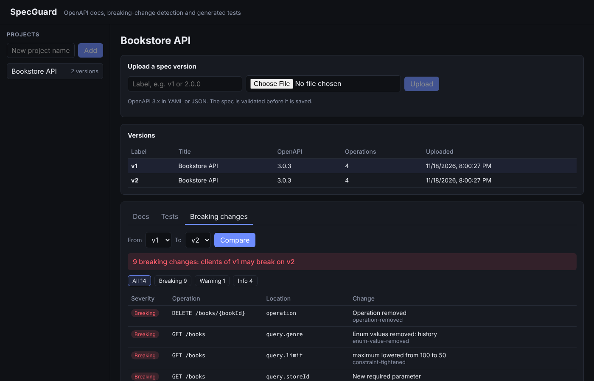

# SpecGuard

**Intelligent API analysis platform.** Upload an OpenAPI 3.x spec and SpecGuard will:

- **Generate documentation** with parameter tables, request/response examples and ready-to-run `curl` commands
- **Detect breaking changes** between two versions of a spec, classified as *breaking*, *warning* or *info*
- **Generate test cases** (positive, negative and edge cases) straight from the schema
- **Run those tests** against a live API and report pass/fail per case



## Why

When an API changes, the question is always the same: *will this break my clients?* Reading a YAML diff doesn't answer it. SpecGuard compares two specs semantically and applies direction-aware rules. For example, a new **required request field** breaks existing clients, while a new **response field** doesn't. It then generates boundary and validation tests so you can check that the implementation actually honours the contract.

## Features

| Area | What it does |
|---|---|
| Parser | OpenAPI 3.0/3.1 in JSON or YAML, local `$ref` resolution (recursion-safe), path-level parameter merging, `allOf` flattening |
| Docs | Markdown grouped by tag, field tables with constraints, example payloads, `curl` snippets, downloadable from the UI |
| Diff | Removed operations/parameters/responses, type changes, new required params or fields, tightened `min`/`max`/`length` constraints, enum changes, content-type changes, deprecations |
| Test generation | Valid requests, missing required params/fields, wrong types, enum violations, min/max and length boundaries |
| Runner | Executes cases over HTTP with timeouts, stores every run in PostgreSQL with status, timing and response excerpt |
| CI-friendly | `POST /analyze/diff` takes two raw specs and returns `is_breaking`, so it can gate a pipeline |

## Architecture

```
frontend/  React + TypeScript (Vite)          ──HTTP──▶  backend/  FastAPI
                                                                │
                                                     app/core/  parser → schema → docs
                                                                        ├─▶ diff
                                                                        └─▶ testgen → runner
                                                                │
                                                        PostgreSQL (SQLAlchemy 2.0)
                                                  projects · spec_versions · test_runs
```

Everything downstream works on one normalized model (`app/core/parser.py`), so `$ref` handling and parameter merging live in a single place. The core modules have no web or database dependencies and are unit-tested on their own.

## Quick start

### With Docker

```bash
docker compose up --build
```

UI at http://localhost:5173, API docs (Swagger) at http://localhost:8000/docs.

### Local development

```bash
# Backend (needs PostgreSQL, or point it at SQLite)
cd backend
pip install -r requirements.txt
export SPECGUARD_DATABASE_URL=sqlite:///./specguard.db   # optional
uvicorn app.main:app --reload

# Frontend
cd frontend
npm install
npm run dev
```

### Try it with the demo API

```bash
cd examples
uvicorn mock_bookstore:app --port 9000
```

Create a project, upload `examples/bookstore-v1.yaml` and `bookstore-v2.yaml`, then:

- **Docs**: generated reference for the selected version
- **Breaking changes**: v1 → v2 reports 9 breaking changes (removed `DELETE`, new required `storeId`, `limit` max lowered, `bookId` type change, …)
- **Tests**: run the 25 generated cases for v1 against `http://localhost:9000`


## API

| Method | Path | Description |
|---|---|---|
| `POST` | `/projects` | Create a project |
| `GET` | `/projects` | List projects with their versions |
| `POST` | `/projects/{id}/versions` | Add a spec version (JSON: `label`, `content`) |
| `POST` | `/projects/{id}/versions/upload` | Add a spec version (multipart file) |
| `GET` | `/versions/{id}` | Version details and operations |
| `GET` | `/versions/{id}/docs` | Generated Markdown docs |
| `GET` | `/versions/{id}/tests` | Generated test cases |
| `POST` | `/versions/{id}/runs` | Run tests against `base_url` |
| `GET` | `/versions/{id}/runs` | Past runs |
| `GET` | `/diff?from={id}&to={id}` | Breaking-change report between two stored versions |
| `POST` | `/analyze/diff` | Stateless diff of two raw specs |

## Tests

```bash
cd backend && pytest
```

The runner tests use an `httpx.MockTransport` implementation of the bookstore API, so the generated expectations are checked against a server that actually follows the spec. CI runs the backend tests and the frontend build on every push.

## Known limitations

- **Stateful APIs**: generated tests run in spec order and some mutate data (e.g. `DELETE /books/1`), so a second run can fail tests that depend on that record. Use a resettable environment, or run only the `positive`/`negative` categories you need.
- Only local `$ref`s (`#/...`) are resolved, and Swagger 2.0 specs must be converted to OpenAPI 3 first.
- Response bodies are not yet validated against the response schema; tests check status codes.
- No authentication support in the runner yet (no auth headers or tokens).

## Roadmap

- [ ] Response schema validation in the runner
- [ ] Auth configuration for test runs (API key, bearer token)
- [ ] .NET Core service for C# source analysis (map controllers to spec operations)
- [ ] RAG assistant to answer questions grounded in specs, generated docs and source code
- [ ] GitHub Action that comments the breaking-change report on pull requests

## Tech stack

FastAPI · SQLAlchemy 2.0 · PostgreSQL · httpx · Pydantic · pytest · React 18 · TypeScript · Vite · Docker · GitHub Actions
